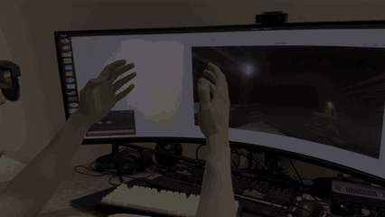

# XR Gate

Experimental open-source XR runtime stack, built to run real VR/XR games and applications with spatial tracking and controller input, while also serving as a low-level AR/XR research platform.

This project is a hardware-independent gateway to VR/XR for devices with limited or no native support. You can use AR glasses with depth cameras (like Xreal Ultra) without any additional hardware as a VR headset or even build your own custom tracker to create your own HMD (Leapmotion/Leapmotion + nRF54L15).

Supported: 
1. 6DoF tracking is supported, both fully stereo and with IMU support (Basalt integration)
2. Image analysis-based hand tracking (Mercury hand tracking integration)
3. Various input devices emulate VR controllers, including those with their own IMUs for precise tracking (Samsung Gear VR support or VR-like Bluetooth controllers)

**For installation and usage instructions, see:**

[Quick Start Linux](#quick-start-linux)

[Quick Start Windows](#quick-start-windows)

[About custom display frequency and video adapters](#about-custom-display-frequency-and-video-adapters)

[About input and controllers](#about-input-and-controllers)


## Supported devices

### Headsets and tracking hardware

| Device | Purpose | IMU | Status | Notes | 
| --- | --- | --- | --- | --- |
| XREAL Air 2 Ultra | Head and hand tracking, display | Built-in | Recommended | Main device |
| Leap Motion UVC + nRF54L15 | Head and hand tracking | External | Experimental | Overall, it works, but the tracking is worse than the Ultra's, and you also need to buy a sensor and print a housing. Soldering is not required. See: https://github.com/vladoshub/xr-tracker |
| Leap Motion UVC | Camera-based tracking | No | Experimental | Poor head tracking, good hand tracking. Sensitive to background details—the more detail, the better the head tracking. Suitable for launching if you already have an UltraLeap. Need to switch to UVC mode - https://github.com/leapmotion/leapuvc |

### Controllers

| Device | Buttons / stick | IMU | Status | Notes |
| --- | --- | --- | --- | --- |
| Samsung Gear VR controller | Yes | Built-in | Supported | Excellent controllers with a touchpad and buttons. Used ones are available. They are powered by two AAA batteries, so there's no battery degradation. They are also lightweight and compact enough to pair well with AR glasses. Currently, hand tracking is supported using the IMU reading. Partial position prediction is also supported using the accelerometer and the last known velocity before optical tracking was lost. It is recommended to calibrate each time you first launch the controller. Operation also depends on the Bluetooth module; a separate module often works better |
| VR-PARK Bluetooth controller | Yes | No | Supported | An inexpensive controller. Suitable for applications where fast movements are not required and only button input is required |
| XR-Controller | ? | Yes | Software support | The code and firmware support buttons with an IMU. However, I've only tested my custom firmware with the nRF54L15 in IMU tracker mode. Theoretically, you could print your own enclosure and connect the buttons to the nRF54L15. Or you could use an existing controller without an IMU with xr-controller. See: https://github.com/vladoshub/xr-controller |


## Half-Life Alyx on HX370 with XREAL Ultra 


<p align="center">
  
</p>


## What it does

The default XREAL Ultra stack is:

```text
XREAL Ultra
  stereo grayscale cameras + IMU
        ↓
capture_service_cpp
  low-latency C++ camera/IMU capture
        ↓
SHM / TCP streams
        ↓
capture_client + backends
  Python stream SDK, 3DoF/6DoF, hand tracking, stereo video, spatial mesh/scanner
        ↓
xr_runtime_adapter
  runtime-rate normalization, Movement prediction, coordinate transforms, controller state, gestures  ← Override controller ← Bluetooth joystick/keyboard
        ↓
drivers and apps
  SteamVR/OpenVR, Monado/OpenXR, debug viewers, optional overlays
```

Current focus areas:

- XREAL Ultra capture and display/runtime integration.
- No vendor SDK required.
- 6DoF VIO through Basalt.
- IMU-only 3DoF fallback and recentering.
- Mercury/ONNX hand-tracking runtime integration.
- Physical controller override input for SteamVR-style interactions.
- Stereo video streaming and optional SteamVR video overlay experiments.
- Live depth grid / spatial proxy mesh / primitive scan output.
- Gestures, movement prediction
- Portable Linux runtime package under `out/xr-gate`.


## Why this project is interesting

For **Computer Vision / Perception / Robotics / Edge AI** work, this repository is more than a demo script. It contains a full real-time perception pipeline around actual hardware:

- synchronized stereo camera + IMU capture;
- stream contracts and shared-memory/TCP transports;
- Kalibr-style dataset recording and calibration tooling;
- VIO backend integration;
- ONNX hand-tracking model integration;
- runtime pose filtering, reacquisition gating, and prediction;
- live spatial grid / mesh publishing;
- debug viewers and health checks for stream timing and image quality.

For **ML / real-time inference / ML infrastructure** work, it demonstrates how models fit into a deployable runtime rather than an isolated notebook:

- explicit model download step instead of vendoring model binaries;
- runtime model directory under `bin/hand-tracking-models/mercury`;
- process orchestration through `xr_client`;
- reproducible build/package scripts;
- separation between project-owned code, third-party code, optional GPL tools, and downloaded model assets.

For **Python/C++ / AR/VR/XR systems** work, it shows cross-language runtime engineering:

- C++ backends for capture, runtime adaptation, drivers, and low-latency paths;
- Python SDK and tools for stream reading, recording, calibration, and debug workflows;
- OpenVR/SteamVR and Monado/OpenXR integration points;
- device-specific package scripts with a portable `out/xr-gate` layout.

## Safety and experimental software notice

XR Gate is experimental software intended for research, development, and hobbyist use.

Use it at your own risk. The project may interact with display modes, cameras, IMU streams, input devices, SteamVR/OpenVR, Monado/OpenXR, and other low-level runtime components. Incorrect configuration, bugs, driver issues, or unsupported hardware setups may cause tracking loss, visual discomfort, broken runtime sessions, display/output issues, or other unexpected behavior.

This project is provided without any warranty. The authors and contributors are not responsible for any damage, data loss, hardware issues, device misuse, personal discomfort, injury, or other consequences resulting from the use of this software, to the fullest extent permitted by applicable law.

Do not use this project in unsafe environments. Make sure you have enough free space around you, avoid fast movement when tracking is unstable, and stop using the software immediately if you experience discomfort, dizziness, eye strain, nausea, or unsafe tracking behavior.

XR Gate is not affiliated with, endorsed by, or sponsored by XREAL, Valve, SteamVR, Monado, or any other vendor unless explicitly stated.

# About custom display frequency and video adapters

**Be careful when setting a custom frequency, as this is not a standard mode and correct operation is not guaranteed.**

The screen refresh rate isn't limited to 60Hz. On Windows, you can configure it through the driver - for example, for NVIDIA, you can do this in the Control Panel.
Also, consider the limitations of video adapters - my USB-C to HDMI adapter allowed me to overclock the refresh rate about 75Hz in SBS.
Aslo example, for Xreal Ultra, you can set the refresh rate to 90Hz (it works in Linux), but for me, this only worked directly via USB-C without adapters. 
So, if you want to connect your device directly to HDMI/DispayPort, you'll need an adapter, or if you don't have a port with USB-C Alt Mode.


# About input and controllers
You can use gestures and controllers.

## Gestures
Gestures try to emulate the controller as much as possible - dpad, trigger, grip, thumbstick, A, B, Menu buttons
See [GESTURES](runtime_adapters/xr_runtime_adapter/configs/GESTURES.md)

## Bluetooth controlles
Currently, two types of Bluetooth controllers are supported: those with and without an IMU.
The difference is that controllers with an IMU allow you to track hand orientation from the IMU, which greatly improves sensitivity and accuracy. 
Prediction when hands leave the camera's field of view is also partially supported (but requires calibration each time you launch).
For Bluetooth, I strongly recommend using a separate adapter to reduce latency—for example, the ASUS USB-BT500.

For Windows/WSL2 Bluetooth, the tested adapter is **ASUS USB-BT500** (`0b05:190e`). Use a dedicated USB Bluetooth adapter for XR Gate so Windows can keep using the system adapter for its keyboard, mouse and headphones.
See the [Windows Bluetooth notes](win/README.md#bluetooth-adapter-for-wsl2), including the MediaTek limitation in the tested WSL kernel.


The controllers emulate the buttons of real VR controllers - at the moment, the Samsung Gear VR covers most of the main buttons and has a touch panel, and also has an IMU

# Quick start Windows
**If your device has a proximity sensor, it may turn off the glasses when you remove them, and the glasses may become detached from the driver. To prevent this, I covered the sensor with Velcro while using it.**

Required Windows 11 + AVX2 Instructions.

Install SteamVR, open it once and close it. Download from the 'Releases' the last xr-gate-windows-wsl-usbip.zip, connect device to PC and enable SBS mode 
if it is supported. Then Open XR-Gate.exe

WSL2 will be installed. The installation is automated — follow the instructions in the interface. For your convenience, the buttons you need to press during installation will flash.


# Quick start Linux
**If your device has a proximity sensor, it may turn off the glasses when you remove them, and the glasses may become detached from the driver. To prevent this, I covered the sensor with Velcro while using it.**

Required AVX2 Instructions.

Tested on Ubuntu 24.04 and Ubuntu 26.04

## 1. Unpack binary (once)


Download these artifacts:

https://github.com/vladoshub/xr-gate/releases/latest

1. xr-gate-linux-x64.tar.gz

2. hand-tracking-models-mercury.tar.gz

3. unpack_xr_gate.sh

Mercury ONNX models are distributed separately in hand-tracking-models-mercury.tar.gz. They are not included in the core runtime package and are not downloaded by the default build.

Download unpack_xr_gate.sh and place it next to:
xr-gate-linux-x64.tar.gz
hand-tracking-models-mercury.tar.gz


Unpack the runtime package and install the Mercury models:
```bash
chmod +x unpack_xr_gate.sh
./unpack_xr_gate.sh --dest ~/xr-gate-release
```


After extraction, the runtime package will be available under:

~/xr-gate-release/xr-gate/...

```bash
cd ~/xr-gate-release/xr-gate
./devices/common/linux/scripts/runtime/install_runtime_deps_ubuntu.sh
```

**For Xreal Ultra - add the user to `video`, `input`, and `plugdev` groups**

```bash
./devices/xreal_ultra/linux/scripts/install_xreal_ultra_device_access.sh
```

**For XR-controller (UltraLeapUVC + nRF54L15) - also add the user to `dialout` and reboot**

```bash
sudo usermod -aG dialout "$USER"
newgrp dialout
reboot
```


## 2. Setting up controllerst (once | optional)


**1. Without this, input will be limited to gestures (pinch, grab).**

**2. Bluetooth controllers, USB keyboards, and joysticks can be mapped to runtime controller input.**

**3. You can use 2 identical Bluetooth controllers.**

**4. I recommend using an external USB Bluetooth device. For example, the ASUS USB-BT500. This can help reduce lag and connection loss if you have built-in Bluetooth.**

**Choose your Device:**

**XREAL ULTRA**
```bash
export DEVICE_CONFIG=xreal_ultra
```

**UltraLeapUVC + nRF54L15**
```bash
export DEVICE_CONFIG=leap_motion_uvc_nrf54l15
```

**UltraLeapUVC**
```bash
export DEVICE_CONFIG=leap_motion_uvc
```


### Switch to external Bluetooth (optional | recomended)

Connect the adapters, stop XR Gate/controller capture, then run the selector from the extracted Ubuntu release:

```bash
python3 bin/scripts/override_controller/select_bluetooth_adapter.py
```
Choose a number, MAC address or `hci` index; Enter cancels without changes.


The selected adapter is powered on and verified **before** the other adapters are powered off. Switching disconnects devices using those other adapters. A failed switch attempts to restore the original power states. This does not change pairing records, firmware or service configuration. Pair controllers with the selected adapter if they were previously paired with another one.


## Choose supported Bluetooth controllers (recomended)

**If you are using controllers with IMU, before launching xr_client, place the controllers on a flat surface for initial calibration and leave them motionless until launch.**

### VR-PARK controllers (NO IMU):

**Perhaps this setting will work with other similar bluetooth joysticks (4 unique action buttons + a simple stick for mouse movement)**


1. Copy config:

```bash
mkdir -p "$HOME/.config/xr_tracking/override_controller"

cp "$HOME/xr-gate-release/xr-gate/bin/override_controller/configs/empty_vrpark.json" \
   "$HOME/.config/xr_tracking/override_controller/default.json"
```

2. Connect controllers to PC

3. Register your controllers:
```bash
~/xr-gate-release/xr-gate/bin/override_controller/override_controller \
  --config "$HOME/.config/xr_tracking/override_controller/default.json" \
  --connect-devices
```

4. Enable auto-start override_controller in client:
   
```bash
CFG="$HOME/xr-gate-release/xr-gate/bin/python/xr_client/configs/$DEVICE_CONFIG.json"
sed -i '/"name": "override_controller"/,/"command":/ s/"start_on_launch": false/"start_on_launch": true/' "$CFG"
```

### Samsung Gear VR controllers (IMU):

1. Stop XR Gate/controller capture. If you use a separate Bluetooth adapter, select it first:
**You can skip this step if the desired adapter is already the only powered adapter.**

```bash
cd ~/xr-gate-release/xr-gate
python3 bin/scripts/override_controller/select_bluetooth_adapter.py
```


2. Put the Gear VR controllers in Bluetooth pairing mode and run:

```bash
python3 bin/scripts/override_controller/bluetooth_controllers.py \
  --config "$HOME/.config/xr_tracking/override_controller/gearvr.json" \
  --template bin/override_controller/configs/empty_gearvr.json
```

Choose the left and right controllers from the list of names and MAC addresses. Enter leaves a side unselected; at least one side is required


3. Enable auto-start for override_controller and Gear VR in the client:


```bash
CFG="$HOME/xr-gate-release/xr-gate/bin/python/xr_client/configs/$DEVICE_CONFIG.json"
sed -i '/"name": "override_controller"/,/"command":/ s/"start_on_launch": false/"start_on_launch": true/' "$CFG"
```

```bash
sed -i \
  -e 's|"CONFIG_PATH": "~/.config/xr_tracking/override_controller/default\.json"|"CONFIG_PATH": "~/.config/xr_tracking/override_controller/gearvr.json"|' \
  -e 's|"PROVIDERS": "evdev"|"PROVIDERS": "evdev,gearvr_ble"|' \
  ~/xr-gate-release/xr-gate/bin/python/xr_client/configs/$DEVICE_CONFIG.json
```


## Train new devices (Optional)
Train your devices.
**Choose this option if you don't have any controllers from the list above or you want to use your own layout (for example, use the keyboard for control)**

```bash
cd ~/xr-gate-release/xr-gate
devices/common/linux/scripts/override_controller/start_override_controller.sh
```

The config will be saved in ~/.config/xr_tracking/override_controller/default.json

If you want to retrain, you can delete default.json for new train

If you use an external controller, you can continue to use controller input when you lose hand tracking (default behavior)

When using external input, hands position and rotation from cameras, input from Wireless controllers and keyboard for rarely buttons


## 3. Run xr_client

**You must launch the client every time before launching SteamVR.**


At startup, you need to select 60Hz or 90Hz mode.
If you have integrated graphics, a USB-C video output, and don't have a separate graphics card, you can try 90Hz mode. Otherwise, I recommend 60Hz.

If 90HZ mode doesn't work for you, go back to 60HZ (you need to re-register the driver from section 3)

It is also recommended to not cover the cameras and have sufficient lighting for tracking to work.

**XREAL ULTRA (recomended, VIO)**
```bash
cd ~/xr-gate-release/xr-gate
./run_xr_client.sh --config xreal_ultra
```

**XREAL ULTRA (no IMU mode, VO)**
```bash
cd ~/xr-gate-release/xr-gate
./run_xr_client.sh --config xreal_ultra --no-imu
```

**UltraLeapUVC + nRF54L15 (experimental, VIO)**
```bash
cd ~/xr-gate-release/xr-gate
./run_xr_client.sh --config leap_motion_uvc_nrf54l15
```

**UltraLeapUVC (experimental, no IMU mod, VO)**
```bash
cd ~/xr-gate-release/xr-gate
./run_xr_client.sh --config leap_motion_uvc
```

You can switch between 3DoF/6DoF or disable/enable hand-tracking without restarting your current session!

CTRL + C - exit from xr_client


If you have completed the train override controller from the previous point, you can use the non-gesture input override. To do this, press 5 after launching.

**Tracking recommendations:**

1. It is recommended not to cover the glasses' cameras. It is also recommended to use the glasses in a bright place.

2. To ensure successful positioning, it is recommended to make small head movements for a few seconds after the initial frame check when starting xr_client.

3. The current hand tracking system isn't perfect, and it's generally recommended to use joysticks instead of gestures (enabling override_controller automatically disables gestures, and vice versa). It is not recommended to wave your arms quickly or block the view of your hands in front of the front camera.

---

## Possible problems
1. xr_client fails frame check on startup. Solution: restart xr_client, re-insert glasses, or restart

2. Hand or head tracking isn't working, or my pose is off somewhere - most likely, tracking received bad frames (not enough light) and can't calculate the pose correctly. 6DoF is  sensitive to video quality, especially during initialization when the backend starts, and can begin to exhibit cumulative errors (unlike hand tracking). It's recommended to restart the backend and slowly rotate your head for a couple of seconds when starting the backend to ensure proper initialization. Press "1" in xr_client to restart backends

3. The glasses don't work in any SBS mode - it could be anything. Try reconnecting the glasses and manually enabling SBS (hold the Brightness Up (+) button on the right temple for 3 seconds until you hear a beep on XREAL Ultra). In the xr_client skip SBS mode selection. It was also noted that if the main display is connected via Type-C, the glasses may not work correctly in SBS.

4. The glasses don't work in any mode - there may be a conflict with the main monitor - try reconnecting the main monitor or changing the frequency on the glasses in the display settings

5. I had problems using Bluetooth controllers. Try re-enabling the controllers themselves.

---


# SteamVR with XREAL Ultra

Steam and SteamVR must be installed from the Steam website, not from Snap. Use an X11/Xorg session.


## Workaround for systems without built-in x11 (Ubuntu 26.04)

### 1. Install LightDM + Xfce


```bash
sudo apt update
sudo apt install -y software-properties-common
sudo add-apt-repository -y universe
sudo apt update

sudo apt install -y \
  lightdm lightdm-gtk-greeter \
  xfce4 xfce4-terminal dbus-x11 \
  xserver-xorg xserver-xorg-input-libinput \
  xserver-xorg-video-amdgpu
```

### 1a. Additional for NVIDIA GPU
```bash
bash <<'BASH'
set -e

LIGHTDM_NATIVE_ARCH="$(dpkg --print-architecture)"

read -r LIGHTDM_NV_GL LIGHTDM_NV_VERSION < <(
  dpkg-query -W \
    -f='${Package} ${Architecture} ${Version} ${db:Status-Status}\n' \
    'libnvidia-gl*' 2>/dev/null |
  awk -v arch="$LIGHTDM_NATIVE_ARCH" \
    '$2 == arch && $4 == "installed" {print $1, $3; exit}'
)

LIGHTDM_NV_XORG="xserver-xorg-video-nvidia${LIGHTDM_NV_GL#libnvidia-gl}"

sudo apt install -y "${LIGHTDM_NV_XORG}=${LIGHTDM_NV_VERSION}"

test -f /usr/lib/xorg/modules/drivers/nvidia_drv.so
BASH
```

### 2. Enable lightdm

```bash
sudo mkdir -p /etc/lightdm/lightdm.conf.d

sudo tee /etc/lightdm/lightdm.conf.d/90-xfce.conf >/dev/null <<'EOF'
[Seat:*]
greeter-session=lightdm-gtk-greeter
user-session=xfce
EOF

sudo dpkg-reconfigure lightdm
```

Choose lightdm and:


```bash
sudo systemctl enable lightdm.service --force
sudo systemctl set-default graphical.target
sudo reboot
```


### 2a. Additional install blueman for convenience and Bluetooth control


```bash
sudo apt update
sudo apt install -y bluez blueman rfkill

sudo systemctl enable --now bluetooth.service
sudo rfkill unblock bluetooth
bluetoothctl power on
```


### Run xr_client

```bash
cd ~/xr-gate-release/xr-gate
./run_xr_client.sh --config xreal_ultra
```

## Use SteamVR

###  Register OpenVR driver (once)

For direct USB4/iGPU path, tested with HX370 iGPU:

90HZ
```bash
cd ~/xr-gate-release/xr-gate
XR_TARGET_DEVICE=xreal_ultra \
XR_DISPLAY_FREQUENCY_HZ=90 \
XR_OPENVR_DISPLAY_FREQUENCY_HZ=90 \
XR_OPENVR_DISPLAY_MODE=direct \
./devices/common/linux/scripts/openvr_driver/register_driver.sh
```

60HZ
```bash
cd ~/xr-gate-release/xr-gate
XR_TARGET_DEVICE=xreal_ultra \
XR_DISPLAY_FREQUENCY_HZ=60 \
XR_OPENVR_DISPLAY_FREQUENCY_HZ=60 \
XR_OPENVR_DISPLAY_MODE=direct \
./devices/common/linux/scripts/openvr_driver/register_driver.sh
```

Custom frequency 75HZ:
```bash
cd ~/xr-gate-release/xr-gate
XR_TARGET_DEVICE=xreal_ultra \
XR_DISPLAY_FREQUENCY_HZ=75 \
XR_OPENVR_DISPLAY_FREQUENCY_HZ=75 \
XR_OPENVR_DRIVER_DIR_NAME=openvr_driver_60HZ \
XR_OPENVR_DISPLAY_MODE=direct \
./devices/common/linux/scripts/openvr_driver/register_driver.sh
```

For NVIDIA dGPU with HDMI/DisplayPort -> Type-C DP adapter, 60 Hz is the safer default:

```bash
cd ~/xr-gate-release/xr-gate
XR_OPENVR_REGISTER_METHOD=manual \
XR_OPENVR_RUNTIME_MODE=steamvr \
XR_TARGET_DEVICE=xreal_ultra \
XR_DISPLAY_FREQUENCY_HZ=60 \
XR_OPENVR_DISPLAY_FREQUENCY_HZ=60 \
XR_OPENVR_DISPLAY_MODE=direct \
./devices/common/linux/scripts/openvr_driver/register_driver.sh
```

For NVIDIA dGPU with HDMI/DisplayPort -> Type-C DP adapter, custom frequency 75HZ:

```bash
cd ~/xr-gate-release/xr-gate
XR_OPENVR_REGISTER_METHOD=manual \
XR_OPENVR_RUNTIME_MODE=steamvr \
XR_TARGET_DEVICE=xreal_ultra \
XR_DISPLAY_FREQUENCY_HZ=75 \
XR_OPENVR_DISPLAY_FREQUENCY_HZ=75 \
XR_OPENVR_DRIVER_DIR_NAME=openvr_driver_60HZ \
XR_OPENVR_DISPLAY_MODE=direct \
./devices/common/linux/scripts/openvr_driver/register_driver.sh
```


**Start xr_client before run SteamVR**

### Start on Integrated GPU with USB-C video output without discrete GPU in system

Tested on HX370


Just start Steam and start SteamVR. After you can start SteamVR apps/games.


### Start on Discrete GPU

Tested on RTX6000 Pro Blackwell


In most cases, you will need an adapter to run the glasses with a dGPU.

Check displays:

```bash
xrandr --query | grep " connected"
```

Example output:

```text
DP-6 connected primary 7680x2160+0+1080
DP-4 connected 3840x1080+1920+0
```

Here:

```text
DP-4 = glasses (3840x1080)
DP-6 = main monitor
```

Run direct mode (tested on Nvidia) 60HZ:
```bash
cd ~/xr-gate-release/xr-gate
XR_OPENVR_DGPU_VENDOR=nvidia \
XR_OPENVR_DGPU_OUTPUT=DP-4 \
XR_OPENVR_LAUNCH_MODE=steam \
XR_OPENVR_CLEAR_LOGS=1 \
XR_DISPLAY_FREQUENCY_HZ=60 \
./run_openvr_dgpu_direct.sh 60
```


Run direct mode (tested on Nvidia) custom frequency 75HZ:
```bash
cd ~/xr-gate-release/xr-gate
XR_TARGET_DEVICE=xreal_ultra \
XR_OPENVR_DGPU_VENDOR=nvidia \
XR_OPENVR_DGPU_OUTPUT=DP-4 \
XR_OPENVR_LAUNCH_MODE=steam \
XR_OPENVR_CLEAR_LOGS=1 \
XR_OPENVR_DRIVER_DIR_NAME=openvr_driver_60HZ \
XR_OPENVR_DISPLAY_MODE=direct \
XR_OPENVR_DISPLAY_FREQUENCY_HZ=75 \
XR_DISPLAY_FREQUENCY_HZ=75 \
./run_openvr_dgpu_direct.sh 75
```

Start SteamVR. After you can start SteamVR apps/games.


After finishing the work, I recommend restoring the glasses to their normal state to avoid problems during future launches or if you have an issue with xr_client or the SteamVR driver:

```bash
cd ~/xr-gate-release/xr-gate

XR_STEAMVR_RESTORE_OUTPUT=DP-4 \
XR_STEAMVR_RESTORE_MAIN_OUTPUT=DP-6 \
XR_STEAMVR_RESTORE_LAYOUT=right-of \
./run_openvr_restore_desktop.sh
```

### Some demo

```bash
cd ~/xr-gate-release/xr-gate
```


Spatial Vision (need running xr_spatial backend)
```bash
./run_steamvr_spatial_scene.sh
```

Stereo overlay (need running xr_video backend)
```bash
./run_steamvr_video_overlay.sh
```

---


# Monado/OpenXR with XREAL Ultra


Run xr_client
```bash
cd ~/xr-gate-release/xr-gate
./run_xr_client.sh --config xreal_ultra
```

## Choose monitor mode

### A. Monado with main monitor — Auto disable main monitor

Example for 90 Hz XREAL Ultra:

```bash
cd ~/xr-gate-release/xr-gate

XR_TARGET_DEVICE=xreal_ultra \
XR_MONADO_DEVICE=xreal_ultra \
XR_DISPLAY_FREQUENCY_HZ=90 \
XR_TRACKING_MONADO_COMPOSITOR_MODE=xcb_fullscreen \
XR_TRACKING_MONADO_XCB_OUTPUT=DisplayPort-1 \
XR_TRACKING_MONADO_XCB_RATE_HZ=90 \
./devices/xreal_ultra/linux/scripts/monado_driver/double_display_fix.sh
```

After stopping Monado driver with `Ctrl+C`, the main display should be restored.

### B. Monado with main monitor — Manually disable main monitor

Check displays:

```bash
xrandr --query | grep " connected"
```

Example output:

```text
DP-6 connected primary 7680x2160+0+1080
DisplayPort-1 connected 3840x1080+1920+0
```

Here:

```text
DisplayPort-1 = glasses
DP-6 = main display
```

Disable main display:

```bash
cd ~/xr-gate-release/xr-gate

XR_TRACKING_MONADO_XCB_OUTPUT=DisplayPort-1 \
XR_TRACKING_MAIN_OUTPUT=DP-6 \
devices/xreal_ultra/linux/scripts/monado_driver/main_display_control.sh off-main
```

Run Monado driver:

```bash
cd ~/xr-gate-release/xr-gate

XR_TARGET_DEVICE=xreal_ultra \
XR_MONADO_DEVICE=xreal_ultra \
XR_DISPLAY_FREQUENCY_HZ=90 \
XR_TRACKING_MONADO_COMPOSITOR_MODE=xcb_fullscreen \
devices/common/linux/scripts/monado_driver/start_monado_driver.sh
```


Enable main display again:

```bash
cd ~/xr-gate-release/xr-gate
XR_TRACKING_MONADO_XCB_OUTPUT=DisplayPort-1 \
XR_TRACKING_MAIN_OUTPUT=DP-6 \
devices/xreal_ultra/linux/scripts/monado_driver/main_display_control.sh on-main
```


### C. Monado with main monitor in system — XCB windowed mode (work with main monitor)

```bash
sudo apt install xdotool wmctrl

cd ~/xr-gate-release/xr-gate

XR_TARGET_DEVICE=xreal_ultra \
XR_MONADO_DEVICE=xreal_ultra \
XR_DISPLAY_FREQUENCY_HZ=90 \
XR_TRACKING_MONADO_COMPOSITOR_MODE=xcb \
XR_TRACKING_MONADO_XCB_OUTPUT=DisplayPort-1 \
./devices/common/linux/scripts/monado_driver/start_monado_driver.sh
```

### D. Monado without main monitor in system

```bash
cd ~/xr-gate-release/xr-gate

XR_TARGET_DEVICE=xreal_ultra \
XR_MONADO_DEVICE=xreal_ultra \
XR_DISPLAY_FREQUENCY_HZ=90 \
XR_TRACKING_MONADO_COMPOSITOR_MODE=xcb_fullscreen \
devices/common/linux/scripts/monado_driver/start_monado_driver.sh
```

### Start OpenXR demo

```bash
cd ~/xr-gate-release/xr-gate
sudo apt install libopenxr-utils
XR_RUNTIME_JSON=~/xr-gate-release/xr-gate/bin/drivers/xreal_ultra/monado_driver/openxr_monado_xrgate.json \
hello_xr -G Vulkan
```


Also you can run OpenVR games through any OpenXR runtime without running SteamVR.
Check /readme/xrizer.md

---


# Linux build:

Clone:
```bash
mkdir -p ~/src
cd ~/src

git clone https://github.com/vladoshub/xr-gate.git xr_tracking
cd xr_tracking
```

Build the complete multi-profile package (vendor components included by default) and download hand-tracking models:
```bash
XR_BUILD_CPU=avx2 XR_DOWNLOAD_HAND_TRACKING_MODELS=1 ./devices/common/linux/scripts/build/install_xr_gate_out.sh
```

Build the complete multi-profile package (vendor components included by default):
```bash
./devices/common/linux/scripts/build/install_xr_gate_out.sh
```

Build only hardware-neutral components and omit pure vendor binaries such as
`xreal_display_helper`:

```bash
XR_BUILD_VENDOR_COMPONENTS=0 \
  ./devices/common/linux/scripts/build/install_xr_gate_out.sh
```

The compatibility entrypoint
`devices/xreal_ultra/linux/scripts/install_xreal_ultra_out.sh` now delegates to
this command and also writes `out/xr-gate`.

Or clean build with ACT:

```bash
./devices/common/linux/scripts/ci/run_xr_gate_act_build.sh \
  --clean-artifacts \
  --full \
  --input build_ubuntu_release=true \
  --input release_windows_driver=false \
  --input publish_release=false \
  --input cpu_profile=avx2
```

ACT build without pure vendor components:

```bash
./devices/common/linux/scripts/ci/run_xr_gate_act_build.sh \
  --no-vendor-components \
  --clean-artifacts \
  --full \
  --input build_ubuntu_release=true \
  --input release_windows_driver=false \
  --input publish_release=false \
  --input cpu_profile=avx2
```


Run it by selecting the runtime profile explicitly:

```bash
cd out/xr-gate

# XREAL Ultra cameras + XREAL Ultra IMU
./run_xr_client.sh --config xreal_ultra

# XREAL display/runtime + Leap Motion UVC cameras + nRF54L15 IMU
./run_xr_client.sh --config leap_motion_uvc_nrf54l15
```

`run_xr_client.sh` intentionally has no implicit hardware profile. Calling it
without `--config` prints the packaged profile list and exits.

## Runtime package

The portable runtime package is built under:

```text
out/xr-gate/
  bin/                                 shared binaries, libraries, Python, apps, drivers
  devices/common/                      hardware-neutral runtime launchers
  devices/xreal_ultra/                 XREAL display/device profile and vendor helpers
  devices/leap_motion_uvc_nrf54l15/    Leap Motion + nRF54L15 tracking profile
  run_xr_client.sh                     config-selected package entrypoint
```

The default profile set is controlled by `XR_PACKAGE_PROFILES`. For advanced
packaging, `XR_PACKAGE_DEVICE_TARGETS` and `XR_PACKAGE_CONFIG_PROFILES` can be
overridden independently.

## Main components

### `capture_service_cpp`

C++ camera/IMU capture backend. The active camera, layout, IMU, and transport settings come from the selected runtime profile.

### `capture_client`

Standalone Python reader SDK for runtime streams. It is used by recorders, calibration tools, debug viewers, and Python-side experiments.

### `backends/`

Tracking and perception backends, including hand tracking, video, spatial mapping/scanning, 3DoF, and 6DoF integration paths.

### `xr_runtime_adapter`

Runtime normalization layer. It consumes backend streams, applies transforms/prediction/stale checks, and republishes runtime-ready HMD, controller, hand, video, and spatial data.

Applications can opt into a read-only TCP JSON stream for HMD/hand/controller
state with `RUNTIME_APP_TCP=1` (off by default). See
[Application TCP/UDP and video access](runtime_adapters/xr_runtime_adapter/docs/application_network_api.md).

### `xr_client`

Process orchestrator for starting, stopping, and supervising the runtime stack.

### `drivers/` and `apps/`

SteamVR/OpenVR, Monado/OpenXR, optional xrizer integration, and experimental SteamVR applications/overlays.

## Source layout

```text
shared/include/                 shared ABI/contracts
capture_client/                 standalone Python reader SDK for SHM/TCP streams
capture_service_cpp/            C++ stereo camera + IMU capture backend
backends/                       hand-tracking/video/spatial backends/3DoF/6DoF
runtime_adapters/               runtime stream normalization
bridges/                        network/UDP bridge tools
apps/steamvr/                   optional SteamVR applications
drivers/                        OpenVR, Monado, and optional xrizer integration
override_controller/            input backend that maps physical controller devices
devices/common/                 shared runtime/build/package scripts
devices/xreal_ultra/            XREAL display/device profile and vendor helpers
devices/leap_motion_uvc_nrf54l15/ Leap Motion + nRF54L15 tracking profile
xr_client/                      process orchestrator and runtime configs
readme/                         additional documentation
```

Upstream code belongs under `third_party/`. Project-owned code is stored normally. Required upstream modifications should be kept as patch files.

More documentation is in the `readme/` folder.

## Optional GPL tools

`xrizer` is an optional third-party GPL-3.0-or-later tool. It is not built by default and is not part of the core binary release.

Build it explicitly:

```bash
cd ~/src/xr_tracking
XR_BUILD_ONLY=xrizer ./devices/common/linux/scripts/build/install_xr_gate_out.sh
```

See `readme/xrizer.md`.

## License

Project-owned source code is licensed under the MIT License. See `LICENSE`.

Third-party files, adapted code, SDKs, binaries, configuration templates, models, and optional tools retain their upstream licenses. Baseline texts are stored in `LICENSES/`, and release packaging collects exact license bundles and source metadata from the pinned upstream checkouts under `LICENSES/components/`.

See `THIRD_PARTY_NOTICES.md` for the component inventory and packaging rules.

## Third-party code and references

The project uses or can build against these third-party components:

- Basalt — 6DoF VIO backend.
- Monado — OpenXR driver/runtime integration and Mercury hand-tracking pipeline integration.
- OpenVR SDK — SteamVR/OpenVR driver integration.
- nrealAirLinuxDriver — MIT-licensed XREAL/NREAL Linux driver reference used for XREAL capture/display work.
- ar-drivers-rs — MIT-licensed AR glasses tooling reference used for XREAL display helper work.
- OpenVR-xrealAirGlassesHMD — reference for OpenVR/XREAL driver behavior and configuration ideas.
- gearVRC — reference for GearVR provider behavior and configuration ideas in override_controller.
- mercury_steamvr_driver — optional source for Mercury hand-tracking ONNX models; not included in the core repository/release.
- xrizer — optional GPL-3.0-or-later OpenVR-to-OpenXR compatibility tool; not built by default.

Driver builds and device-specific paths: [DEVICE_PACKAGES.md](drivers/DEVICE_PACKAGES.md).
